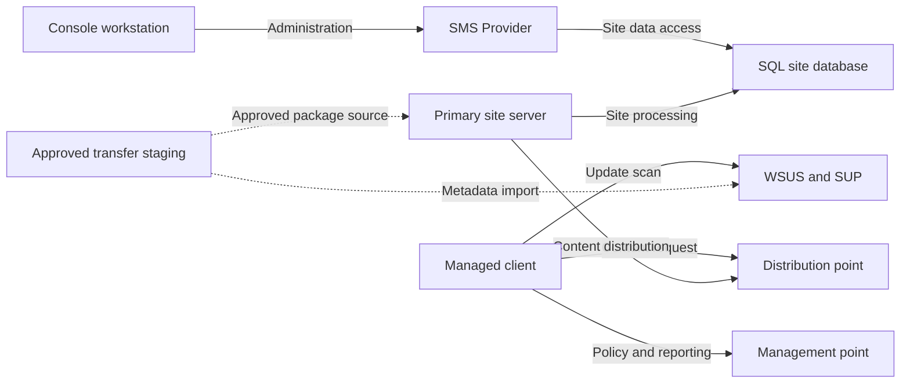

# Record and verify the MECM site architecture

**Status:** Draft; source reviewed 2026-11-26; target-system validation required.

## Service context

Use this guide to produce a private, verified as-built record for an offline
Configuration Manager current branch standalone primary site. It is an inventory
and design-review procedure. It does not install roles or authorize network
changes. Record the actual site, console, client, Windows and SQL builds; check
them against Microsoft's [supported configurations](https://learn.microsoft.com/en-us/intune/configmgr/core/plan-design/configs/supported-configurations).

A standalone primary can manage clients without a central administration site.
Choose topology against measured scale and availability requirements, using
Microsoft's [hierarchy design guidance](https://learn.microsoft.com/en-us/intune/configmgr/core/plan-design/hierarchy/design-a-hierarchy-of-sites).
Separate roles can improve placement and fault isolation but introduce additional
hosts, network paths, certificates and maintenance responsibilities. Colocated
roles still have separate responsibilities and shared failure dependencies.

| Component | Responsibility to record | Owner to identify privately |
| --- | --- | --- |
| Primary site server | Site processing and coordination | MECM service owner |
| SMS Provider | Console/API access to site data, subject to administrative rights | MECM/platform owner |
| SQL site database | Configuration, resource and state data | DBA and backup owner |
| Management point (MP) | Client policy, location information and client reporting | MECM owner |
| Distribution point (DP) | Approved deployment content supplied to clients | Content/platform owner |
| WSUS/software update point (SUP) | Update metadata and client update scanning | Patching owner |
| Service connection point | Offline servicing workflow | Site servicing owner |

The [SMS Provider](https://learn.microsoft.com/en-us/intune/configmgr/core/plan-design/hierarchy/plan-for-the-sms-provider)
serves administration, not client policy. A working console therefore does not
prove clients can contact their MP. The WSUS database, `SUSDB`, and the
Configuration Manager site database are different stores, even if they share a
SQL host. See the existing [SQL and accounts guide](https://github.com/brandonrhymer/csfc_scripts/blob/main/mecm/docs/sql-and-accounts.md)
and [WSUS/SUP setup guide](https://github.com/brandonrhymer/csfc_scripts/blob/main/mecm/docs/wsus-sup-setup.md).

## Trigger and entry criteria

Complete this record before accepting a new site, adding a network location,
moving a role, changing communication security, or reviewing an incident whose
path is unclear. Enter with a named service owner, an authorized read-only review,
and the previous as-built record if one exists. A missing record is a finding;
do not infer approval from an existing configuration.

## Prerequisites

Use the approved console workstation with a scoped read account. Ask the host,
network, PKI and SQL owners to supply facts unavailable to that account. Elevated
host or SQL administration is not required merely to draw the architecture.

Prepare a private worksheet containing:

- Site code, site and console builds, support-check date and installed roles.
- Host/FQDN, address, network zone, OS/build, role owner and maintenance owner.
- SQL instance, database names, storage paths, backup destination and recovery owner.
- Approved client networks, boundary groups, communication modes and certificate dependencies.
- Content sources, staging/transfer locations, manifests and transfer custodians.
- Expected service hours, locally chosen capacity alerts, recovery objectives and evidence location.

Keep actual identifiers, account names and network rules in the authorized system
of record. This public guide uses only synthetic examples and placeholders.

## Procedure

### 1. Establish the role map

1. Open **Administration > Site Configuration > Sites**. Select the intended
   site. Record its name, code and version; inspect **Properties** without saving
   changes. Confirm the record represents the intended standalone primary.
2. In the site's **Properties > General**, record the **SMS Provider location**.
   Compare it with the console connection and the host inventory. Record each
   Provider if there is more than one. Expected result: administration has a
   named entry point and database dependency.
3. Open **Administration > Site Configuration > Servers and Site System Roles**.
   Select each server and record the roles shown in the lower pane. For MP, DP
   and SUP roles, inspect properties and record the configured communication
   options. Confirm the service connection point's offline mode. Close dialogs
   with **Cancel** after inspection.
4. Have the DBA confirm the site database and SUSDB placement. Have the platform
   owner confirm volume assignments and monitoring. Resolve differences between
   console, host and previous records before marking any value verified.

### 2. Draw separate flows

Use this synthetic diagram as a reading aid. Boxes can share one host; arrows
describe the named activity, not a complete firewall specification.

1. Trace one client's policy/reporting route separately from its scan and content
   routes. Mark the assigned site and actual MP, SUP and DP. Update scanning uses
   metadata; deployment content comes through the content infrastructure. Neither
   a successful scan nor a successful distribution proves installation. See
   [software update fundamentals](https://learn.microsoft.com/en-us/intune/configmgr/sum/understand/software-updates-introduction).
2. Trace administration from the console to the Provider and site database.
   Record DNS, domain authentication and certificate dependencies. Do not draw
   direct console database writes as a supported administration workflow.
3. Trace external acquisition to approved transfer staging, then metadata import
   and content-source placement as separate activities. Document media custody,
   integrity checks and the importer. Use the existing
   [offline acquisition procedure](https://github.com/brandonrhymer/csfc_scripts/blob/main/mecm/docs/offline-content-acquisition.md).
   Do not add Internet fallback or change a shared connected WSUS source.
4. Record site servicing as a separate controlled transfer workflow using
   [offline site servicing](https://github.com/brandonrhymer/csfc_scripts/blob/main/mecm/docs/offline-site-servicing.md).
   An update payload import does not service the MECM site itself.

### 3. Complete a directional network worksheet

Create one row per initiator, destination, purpose and security mode. Use the
installed configuration and Microsoft's [directional port reference](https://learn.microsoft.com/en-us/intune/configmgr/core/plan-design/hierarchy/ports),
including its notes. These examples identify flows to investigate; they are not
an allow-all rule set.

| Initiator to destination | Purpose and ports to verify |
| --- | --- |
| Console to site server/Provider | WMI/RPC administration and Provider discovery; document RPC endpoint and dynamic-port requirements |
| Provider/site server to SQL | Actual static SQL listener; document any separately required SQL services |
| Client to MP | Configured HTTP/HTTPS policy/reporting; client notification is a separate connection |
| Client to DP | Configured HTTP/HTTPS content retrieval |
| Client to WSUS/SUP | Actual WSUS HTTP/HTTPS bindings, often 8530/8531 |
| Site server to remote site systems | Installation, management and content transfer paths required by those roles |
| Relevant hosts to DNS/AD/time/PKI | Name resolution, authentication, time and revocation dependencies |

1. For each row, record actual addresses, protocol, destination port/range,
   direction, firewall rule identifier, certificate mode and network owner.
2. Distinguish traffic initiated by either endpoint from response traffic on an
   established connection. Add conditional features only when enabled, such as
   pull-DP source retrieval or peer content sources.
3. Ask the network owner to reconcile the worksheet with current rules. Any
   connection test needs its own authorized scope. A listening TCP port alone
   does not verify authentication, policy retrieval or content integrity.

### 4. Verify location, fallback and storage decisions

1. Inspect **Administration > Hierarchy Configuration > Boundaries** and
   **Boundary Groups**. Record each client network, group membership and assigned
   site. Inspect **References** for associated servers and **Relationships** for
   permitted neighbors and fallback. Inspect default-site-group behavior too.
2. Review overlaps with the network owner. A client can match multiple groups;
   their service-location and fallback effects must be deliberate. Boundary
   groups do not define deployment membership or replace firewall isolation.
   Use [boundary-group behavior](https://learn.microsoft.com/en-us/intune/configmgr/core/servers/deploy/configure/boundary-groups)
   and [collection targeting](collection-targeting.md) for these separate controls.
3. Record content source, site/DP content-library and client-cache capacity
   separately. Add SQL data/log/tempdb, WSUS and backup capacity. Record available
   space, observed growth, alert owner and locally approved response thresholds;
   do not invent one universal disk size. Content moves consume storage and
   network capacity; see [content management fundamentals](https://learn.microsoft.com/en-us/intune/configmgr/core/plan-design/hierarchy/fundamental-concepts-for-content-management).

## Verification and expected results

Accept the record when every role has a host and owner, every necessary route
has a documented initiator/destination, and one representative client per
approved network has an assigned-site and service-location evidence reference.
Use existing [onboarding checkpoints](https://github.com/brandonrhymer/csfc_scripts/blob/main/mecm/docs/client-onboarding.md)
for operational validation under an approved test change. Review unserved
networks, overlap, fallback and single-host failures explicitly. Do not mark a
diagram as target-validated when only configuration was inspected.

## Exceptions, recovery and escalation

Stop a dependent change when the role host, owner, communication mode or intended
route is unknown. Send the disputed worksheet row and observation time to the
responsible service/network/DBA/PKI owner. Keep current configuration unchanged
while reconciling an inventory discrepancy. Recovery of a failed site follows
the existing [backup and recovery guide](https://github.com/brandonrhymer/csfc_scripts/blob/main/mecm/docs/backup-recovery.md),
not role deletion or ad hoc SQL edits.

## Closure and records

Store the versioned diagram, role inventory, network worksheet, storage baseline,
evidence references and unresolved decisions privately. Record reviewer, review
date and next review trigger. Open a tracked action for each unverified item;
the as-built review is complete only when its disposition is explicit.

## References

Microsoft references are linked beside their relevant decisions. Use the
[preparation checklist](https://github.com/brandonrhymer/csfc_scripts/blob/main/mecm/docs/01-prepare.md)
for new-build prerequisites and [communication security](https://github.com/brandonrhymer/csfc_scripts/blob/main/mecm/docs/communication-security.md)
for HTTPS/Enhanced HTTP implementation. Use [certificate lifecycle](certificate-lifecycle.md)
for the ongoing PKI branch when that design applies.

[MECM guide index](README.md)
